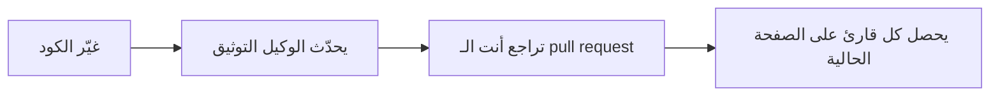
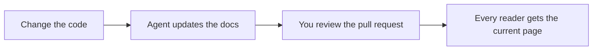

# المكوّنات

تغطّي المكوّنات ما لا تستطيعه Markdown العادية: الخطوات، والتبويبات، والبطاقات، والفيديو. اكتب المكوّن على شكل وسم بصيغة PascalCase في سطر مستقل، مع سطر فارغ قبله وبعده. والمحتوى داخله Markdown.

```markdown
<Callout type="warning" title="Before you deploy">
Run `php artisan optimize` so the first reader never waits.
</Callout>
```

| ما تريده | استخدم |
| --- | --- |
| ملاحظة أو نصيحة أو تحذير | [Callout](#callout)، أو تنبيه GitHub |
| إجراء مرقّم | [Steps](#steps) |
| بدائل يختار القارئ منها | [Tabs](#tabs) |
| أوامر أو ملفات تنتمي إلى بعضها | [CodeGroup](#codegroup) |
| روابط إلى صفحات أخرى، على شكل كتل | [Card و CardGroup](#card-and-cardgroup) |
| محتوى جنبًا إلى جنب | [Columns](#columns) |
| تفاصيل يستطيع معظم القرّاء تخطّيها | [Accordion](#accordion-and-accordiongroup) |
| تسمية حالة | [Badge](#badge) |
| الإجراء الوحيد الذي تقود إليه الصفحة | [Button](#button) |
| بنية مجلد | [FileTree](#filetree) |
| لقطة شاشة أو مخطط مع تعليق | [Frame](#frame) |
| فيديو | [Video](#video) |
| مخطط من نص | [Mermaid](#mermaid) |
| معادلة | [Math](#math) |

يُصيَّر كل مكوّن أيضًا HTML عاديًا للقرّاء من دون JavaScript، و Markdown قابلًا للنقل في نسخة Markdown الخاصة بالصفحة للوكلاء. ويسرد [مرجع المكوّنات](../reference/components.md) الخصائص (props) لكل مكوّن، وكلا الشكلين.

## كيف تكتب مكوّنًا {#how-to-write-one}

- المكوّن الذي لا محتوى له يغلق نفسه: `<Video ... />`. والمكوّن القصير يمكن أن يأتي في سطر واحد: `<Badge tone="success">Stable</Badge>`.
- الخصائص نصوص بين علامتي تنصيص. والخاصية المجرّدة تعني true، و JSON يوضع بين قوسين معقوفين (`cols={3}`).
- لكل مكوّن أيضًا صيغة توجيه تبدأ بـ `:::`، موصوفة في [Markdown](markdown.md#directives).
- الوسم غير المعروف، أو خطأ إملائي مثل `<Calout>`، يُصيَّر نصًا مهرّبًا. ويبلّغ عنه `php artisan larecipe:validate` بالرمز `components.unknown`، وعن الخاصية الناقصة أو غير الصالحة بالرمز `components.props`.
- يتجاهل المكوّن المدمج الخصائص التي لا يعلنها، فلا أثر لخاصية مكتوبة خطأً. راجع [المرجع](../reference/components.md) للأسماء الدقيقة.

## Callout

ملاحظة أو نصيحة أو تحذير منفصل عن النص. قيمة `type` هي `note` أو `tip` أو `important` أو `warning` أو `caution` أو `danger` (وتعمل `info` و `success` أيضًا). والخاصية الاختيارية `title` تحلّ محلّ التسمية.

<Callout type="warning" title="قبل أن تنشر">
شغّل `php artisan optimize` كي لا ينتظر أول قارئ بعد النشر تصييرَ الصفحة أبدًا.
</Callout>

```markdown
<Callout type="warning" title="Before you deploy">
Run `php artisan optimize` so the first reader after a deploy never waits for a page to render.
</Callout>
```

ينتج تنبيه GitHub المكوّن نفسه، ويُقرأ جيدًا على GitHub أيضًا:

> [!NOTE]
> التنبيهات ووسوم callout تنتج المكوّن نفسه.

```markdown
> [!NOTE]
> Alerts and callout tags produce the same component.
```

## Steps

إجراء مرقّم. تحتاج كل `Step` إلى `title`، ومحتواها Markdown، بما فيه كتل الكود.

<Steps>

<Step title="أضف الحزمة">

```bash
composer require larecipe/larecipe
```

</Step>

<Step title="شغّل المثبّت">

```bash
php artisan larecipe:install
```

</Step>

<Step title="افتح التوثيق">
زر `/docs`. صفحة المقدمة موجودة هناك أصلًا.
</Step>

</Steps>

````markdown
<Steps>

<Step title="Require the package">

```bash
composer require larecipe/larecipe
```

</Step>

<Step title="Run the installer">

```bash
php artisan larecipe:install
```

</Step>

<Step title="Open your docs">
Visit `/docs`. Your Introduction page is already there.
</Step>

</Steps>
````

## Tabs

المعلومة نفسها في بدائل يختار القارئ منها: مدير حزم، أو إطار عمل، أو مشغّل مصدر. يحتاج كل `Tab` إلى `label`. ويختار `default` التبويب الذي يظهر أولًا، والتبويبات التي تتشارك مفتاح `sync` تتبدّل معًا في الصفحة كلها.

<Tabs sync="driver">

<Tab label="المستودع">
يعيش التوثيق في `docs/` بصيغة Markdown، في الـ pull request نفسه مع الكود.

```bash
php artisan larecipe:install --driver=repository
```

</Tab>

<Tab label="قاعدة البيانات">
يعيش التوثيق في قاعدة بياناتك، ويتغيّر عبر ترحيلات التوثيق.

```bash
php artisan larecipe:install --driver=database
```

</Tab>

</Tabs>

````markdown
<Tabs sync="driver">

<Tab label="Repository">
Docs live in `docs/` as Markdown, in the same pull request as the code.

```bash
php artisan larecipe:install --driver=repository
```

</Tab>

<Tab label="Database">
Docs live in your database and change through docs migrations.

```bash
php artisan larecipe:install --driver=database
```

</Tab>

</Tabs>
````

من دون JavaScript تظهر كل اللوحات بالترتيب، كلٌّ تحت تسميته، فلا شيء يُخفى عن القارئ ولا عن محرّكات الزحف.

## CodeGroup

عدة كتل كود تنتمي إلى بعضها، تُعرض تبويباتٍ فوق لوحة كود واحدة. ويصبح عنوان كل كتلة، أو لغتها، تسمية التبويب.

<CodeGroup>

```bash title="تشغيل تجريبي"
php artisan larecipe:upgrade
```

```bash title="تطبيق"
php artisan larecipe:upgrade --apply
```

</CodeGroup>

````markdown
<CodeGroup>

```bash title="Dry run"
php artisan larecipe:upgrade
```

```bash title="Apply"
php artisan larecipe:upgrade --apply
```

</CodeGroup>
````

## Card و CardGroup {#card-and-cardgroup}

كتلة مرتبطة برابط، لها عنوان ووصف قصير. تأخذ `href` رابط `.md` نسبيًا، وتأخذ `icon` اسم أيقونة من Lucide. ويرتّب `CardGroup` البطاقات في أعمدة (`cols`، والقيمة الافتراضية 2).

<CardGroup cols="2">

<Card title="التثبيت" href="../get-started/installation.md" icon="rocket">
من `composer require` إلى موقع توثيق يعمل، مع كل خيارات المثبّت.
</Card>

<Card title="مرجع المكوّنات" href="../reference/components.md" icon="book-open">
كل خاصية لكل مكوّن مدمج.
</Card>

</CardGroup>

```markdown
<CardGroup cols="2">

<Card title="Installation" href="../get-started/installation.md" icon="rocket">
From `composer require` to a working docs site, with every installer flag.
</Card>

<Card title="Components reference" href="../reference/components.md" icon="book-open">
Every prop of every built-in component.
</Card>

</CardGroup>
```

البطاقة التي لا `href` لها كتلة ذات عنوان. ويسرد [مرجع المكوّنات](../reference/components.md) أسماء الأيقونات التي يمكن للبطاقة أن تستخدمها.

## Columns

محتوى جنبًا إلى جنب على الشاشات العريضة، ومكدّس على الضيّقة. تصبح كل كتلة داخله عمودًا: فقرة، أو بطاقة، أو كتلة كود. والقيمة الافتراضية لـ `cols` هي 2.

<Columns cols="2">

**للناس.** موقع سريع يُقرأ جيدًا مع JavaScript أو من دونها، في الوضع الفاتح والداكن.

**للوكلاء.** الصفحة نفسها بصيغة Markdown، إضافة إلى `llms.txt` و `skill.md` و MCP.

</Columns>

```markdown
<Columns cols="2">

**For people.** A fast site that reads well with or without JavaScript, in light and dark.

**For agents.** The same page as Markdown, plus `llms.txt`, `skill.md` and MCP.

</Columns>
```

## Accordion و AccordionGroup {#accordion-and-accordiongroup}

أقسام قابلة للطيّ لتفاصيل يستطيع معظم القرّاء تخطّيها. يحتاج كل `Accordion` إلى `title`، وتجعله `open` يبدأ مفتوحًا. ويُبقي `AccordionGroup` مجموعة متتالية منها معًا. ويقرأ الوكلاء المحتوى دائمًا، مفتوحًا.

<AccordionGroup>

<Accordion title="هل يحتاج LaRecipe إلى Node على خادمي؟">
لا. واجهة القراءة تأتي مبنية مسبقًا داخل الحزمة. ولا حاجة إلى Node إلا لبناء مكوّنات React الخاصة بك، على جهازك أو في CI.
</Accordion>

<Accordion title="هل يمكن أن يبقى توثيقي في مستودعي؟" open>
نعم، وهذا هو المصدر الافتراضي والموصى به. ومصدر قاعدة البيانات موجود للفرق التي تريد لوحة إدارة.
</Accordion>

</AccordionGroup>

```markdown
<AccordionGroup>

<Accordion title="Does LaRecipe need Node on my server?">
No. The reader UI ships prebuilt inside the package. Node is needed only to build your own React components, on your machine or in CI.
</Accordion>

<Accordion title="Can my docs stay in my repository?" open>
Yes, that is the default and the recommended source. The database source is there for teams who want an admin UI.
</Accordion>

</AccordionGroup>
```

## Badge

تسمية حالة قصيرة. قيمة `tone` هي `neutral` أو `info` (الافتراضية) أو `success` أو `warning` أو `danger`. اكتبها في سطر واحد.

<Badge tone="success">مستقر</Badge>

<Badge tone="warning">تجريبي</Badge>

```markdown
<Badge tone="success">Stable</Badge>

<Badge tone="warning">Beta</Badge>
```

## Button

رابط بشكل زر، للإجراء الوحيد الذي تقود إليه الصفحة. قيمة `variant` هي `primary` (الافتراضية) أو `secondary` أو `outline` أو `ghost`. استخدمه باعتدال: فالصفحة التي فيها عدة أزرار لا إجراء رئيسيًا لها. ومن دون `href` يُصيَّر تسمية ثابتة، كما كانت أزرار العرض في LaRecipe 2.

<Button href="../get-started/installation.md" variant="outline">ثبّت LaRecipe</Button>

```markdown
<Button href="../get-started/installation.md" variant="outline">Install LaRecipe</Button>
```

## FileTree

بنية مجلد، تُكتب قائمة Markdown متداخلة داخل الوسم. وتنتهي المجلدات بشرطة مائلة عُرفًا.

<FileTree>

- docs/
  - larecipe.json
  - 3.x/
    - navigation.json
    - index.md
    - get-started/
      - installation.md

</FileTree>

```markdown
<FileTree>

- docs/
  - larecipe.json
  - 3.x/
    - navigation.json
    - index.md
    - get-started/
      - installation.md

</FileTree>
```

## Frame

تعليق لوسائط، عادة لقطة شاشة أو مخطط. وتجعل الإطارات صورتها قابلة للتكبير في المتصفح. ويمكن أن يكون المحتوى أي Markdown: صورة، أو جدولًا، أو كتلة كود.

<Frame caption="الأمران اللذان يثبّتان LaRecipe.">

```bash
composer require larecipe/larecipe
php artisan larecipe:install
```

</Frame>

````markdown
<Frame caption="The two commands that install LaRecipe.">

```bash
composer require larecipe/larecipe
php artisan larecipe:install
```

</Frame>
````

للقطة الشاشة، ضع الصورة داخله: `` بين الوسمين، مع الملف بجوار الصفحة أو في مجلد `_assets` الخاص بالإصدار.

## Video

فيديو لا يُحمَّل إلا حين يطلبه القارئ. تأخذ `src` ملف فيديو، أو رابطًا من YouTube أو Vimeo أو Loom، وتملأ `poster` و `title` و `duration` الإطار وتعليقه. ويظهر الفيديو المستضاف رابطًا مثل "شاهد على YouTube" حتى يشغّله القارئ، فلا يُحمَّل شيء من طرف ثالث مع الصفحة.

ما دام التسجيل غير موجود، اترك `src`. عندئذ يقول الإطار ما الذي سيأتي: نص `placeholder` الذي كتبته، أو "العرض المصوّر قريبًا" بلغة الصفحة. ويظل `php artisan larecipe:validate` يذكّرك بتحذير `media.placeholder`.

<Video placeholder="مثال على عنصر نائب: يبقى هذا الإطار حتى يوجد التسجيل" />

```markdown
<Video placeholder="An example placeholder: this frame stays until the recording exists" />

<Video src="https://www.youtube.com/watch?v=VIDEO_ID" title="LaRecipe in two minutes" duration="2:40" />
```

<Accordion title="كيف يُختار عنوان المشغّل">

يستنتج LaRecipe عنوان المشغّل من `src` نفسه، فلا تستطيع الصفحة أن توجّه المشغّل إلى أي مكان آخر. ويُشغَّل ملف الفيديو في عنصر `<video>` أصلي. ولا يؤطّر المشغّل إلا YouTube (عبر `youtube-nocookie.com`) و Vimeo و Loom، عبر `https`.

</Accordion>

## Mermaid

مخطط من نص. اكتب سياج ` ```mermaid `، أو الوسم `<Mermaid>` مع المصدر نفسه داخله. ويُصيَّر المخطط بألوان المظهر حين يقترب من منطقة العرض أثناء التمرير.



````markdown

````

## Math

معادلة بصيغة TeX. اكتب كتلة `$$`، أو الوسم `<Math>`. وتُنضَّد المعادلة في المتصفح.

$$
e^{i\pi} + 1 = 0
$$

```markdown
$$
e^{i\pi} + 1 = 0
$$
```

## المراجع الحية وكتل الصلاحيات {#live-references-and-gate-blocks}

عائلتان أخريان تستخدمان صيغة الوسوم نفسها. المراجع الحية (`<Route>` و `<Artisan>` و `<Model>` و `<Event>`) تقرأ الحقائق من تطبيقك العامل، فلا يمكن أن تصبح قديمة: راجع [المراجع الحية](live-references.md). وكتل الصلاحيات (`<Can>` و `<Cannot>`) لا تُظهر القسم إلا للقرّاء الذين تسمح لهم بواباتك (gates): راجع [كتل الصلاحيات](gate-blocks.md).

## التالي {#next}

- [كتل الكود](code-blocks.md): العناوين، وتمييز الأسطر، والفروق، وأمثلة من الكود الخاص بك.
- [مرجع المكوّنات](../reference/components.md): كل خاصية، وما يُصيَّر به كل مكوّن في HTML و Markdown.
- [مكوّنات React المخصّصة](../customize/custom-components.md): أضف مكوّناتك الخاصة.
