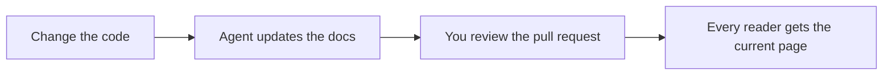

# Components

Components cover what plain Markdown cannot: steps, tabs, cards, a video. Write one as a PascalCase tag on its own line, with a blank line before and after. The content inside is Markdown.

```markdown
<Callout type="warning" title="Before you deploy">
Run `php artisan optimize` so the first reader never waits.
</Callout>
```

| You want | Use |
| --- | --- |
| A note, tip or warning | [Callout](#callout), or a GitHub alert |
| A numbered procedure | [Steps](#steps) |
| Alternatives the reader picks from | [Tabs](#tabs) |
| Commands or files that belong together | [CodeGroup](#codegroup) |
| Links to other pages, as blocks | [Card and CardGroup](#card-and-cardgroup) |
| Content side by side | [Columns](#columns) |
| Detail most readers can skip | [Accordion](#accordion-and-accordiongroup) |
| A status label | [Badge](#badge) |
| The one action a page leads to | [Button](#button) |
| A folder layout | [FileTree](#filetree) |
| A screenshot or diagram with a caption | [Frame](#frame) |
| A video | [Video](#video) |
| A diagram from text | [Mermaid](#mermaid) |
| A formula | [Math](#math) |

Every component also renders as plain HTML for readers without JavaScript, and as portable Markdown in the page's twin for agents. The [components reference](../reference/components.md) lists each one's props and both forms.

## How to write one

- A component without content closes itself: `<Video ... />`. A short one can sit on one line: `<Badge tone="success">Stable</Badge>`.
- Props are quoted strings. A bare prop means true, and JSON goes in braces (`cols={3}`).
- Each component also has a `:::` directive form, described in [Markdown](markdown.md#directives).
- An unknown tag, or a typo such as `<Calout>`, renders as escaped text. `php artisan larecipe:validate` reports it as `components.unknown`, and a missing or invalid prop as `components.props`.
- A built-in component ignores props it does not declare, so a misspelled prop has no effect. Check the [reference](../reference/components.md) for the exact names.

## Callout

A note, tip or warning set apart from the text. `type` is `note`, `tip`, `important`, `warning`, `caution` or `danger` (`info` and `success` work too). An optional `title` replaces the label.

<Callout type="warning" title="Before you deploy">
Run `php artisan optimize` so the first reader after a deploy never waits for a page to render.
</Callout>

```markdown
<Callout type="warning" title="Before you deploy">
Run `php artisan optimize` so the first reader after a deploy never waits for a page to render.
</Callout>
```

A GitHub alert produces the same component, and also reads well on GitHub:

> [!NOTE]
> Alerts and callout tags produce the same component.

```markdown
> [!NOTE]
> Alerts and callout tags produce the same component.
```

## Steps

A numbered procedure. Each `Step` needs a `title`; its content is Markdown, code blocks included.

<Steps>

<Step title="Require the package">

```bash
composer require larecipe/larecipe
```

</Step>

<Step title="Run the installer">

```bash
php artisan larecipe:install
```

</Step>

<Step title="Open your docs">
Visit `/docs`. Your Introduction page is already there.
</Step>

</Steps>

````markdown
<Steps>

<Step title="Require the package">

```bash
composer require larecipe/larecipe
```

</Step>

<Step title="Run the installer">

```bash
php artisan larecipe:install
```

</Step>

<Step title="Open your docs">
Visit `/docs`. Your Introduction page is already there.
</Step>

</Steps>
````

## Tabs

The same information in alternatives the reader picks from: a package manager, a framework, a source driver. Each `Tab` needs a `label`. `default` picks the tab shown first, and tabs that share a `sync` key switch together across the page.

<Tabs sync="driver">

<Tab label="Repository">
Docs live in `docs/` as Markdown, in the same pull request as the code.

```bash
php artisan larecipe:install --driver=repository
```

</Tab>

<Tab label="Database">
Docs live in your database and change through docs migrations.

```bash
php artisan larecipe:install --driver=database
```

</Tab>

</Tabs>

````markdown
<Tabs sync="driver">

<Tab label="Repository">
Docs live in `docs/` as Markdown, in the same pull request as the code.

```bash
php artisan larecipe:install --driver=repository
```

</Tab>

<Tab label="Database">
Docs live in your database and change through docs migrations.

```bash
php artisan larecipe:install --driver=database
```

</Tab>

</Tabs>
````

Without JavaScript every panel shows in order under its label, so nothing is hidden from a reader or a crawler.

## CodeGroup

Several code blocks that belong together, shown as tabs over one code panel. Each block's title, or its language, becomes the tab label.

<CodeGroup>

```bash title="Dry run"
php artisan larecipe:upgrade
```

```bash title="Apply"
php artisan larecipe:upgrade --apply
```

</CodeGroup>

````markdown
<CodeGroup>

```bash title="Dry run"
php artisan larecipe:upgrade
```

```bash title="Apply"
php artisan larecipe:upgrade --apply
```

</CodeGroup>
````

## Card and CardGroup

A linked block with a title and a short description. `href` takes a relative `.md` link, and `icon` takes a Lucide icon name. `CardGroup` lays cards out in columns (`cols`, default 2).

<CardGroup cols="2">

<Card title="Installation" href="../get-started/installation.md" icon="rocket">
From `composer require` to a working docs site, with every installer flag.
</Card>

<Card title="Components reference" href="../reference/components.md" icon="book-open">
Every prop of every built-in component.
</Card>

</CardGroup>

```markdown
<CardGroup cols="2">

<Card title="Installation" href="../get-started/installation.md" icon="rocket">
From `composer require` to a working docs site, with every installer flag.
</Card>

<Card title="Components reference" href="../reference/components.md" icon="book-open">
Every prop of every built-in component.
</Card>

</CardGroup>
```

A card without `href` is a block with a title. The [components reference](../reference/components.md) lists the icon names a card can use.

## Columns

Content side by side on wide screens, stacked on narrow ones. Each block inside becomes a column: a paragraph, a card, a code block. `cols` defaults to 2.

<Columns cols="2">

**For people.** A fast site that reads well with or without JavaScript, in light and dark.

**For agents.** The same page as Markdown, plus `llms.txt`, `skill.md` and MCP.

</Columns>

```markdown
<Columns cols="2">

**For people.** A fast site that reads well with or without JavaScript, in light and dark.

**For agents.** The same page as Markdown, plus `llms.txt`, `skill.md` and MCP.

</Columns>
```

## Accordion and AccordionGroup

Collapsible sections for detail most readers can skip. Each `Accordion` needs a `title`; `open` starts it expanded. `AccordionGroup` keeps a run of them together. Agents always read the content, expanded.

<AccordionGroup>

<Accordion title="Does LaRecipe need Node on my server?">
No. The reader UI ships prebuilt inside the package. Node is needed only to build your own React components, on your machine or in CI.
</Accordion>

<Accordion title="Can my docs stay in my repository?" open>
Yes, that is the default and the recommended source. The database source is there for teams who want an admin UI.
</Accordion>

</AccordionGroup>

```markdown
<AccordionGroup>

<Accordion title="Does LaRecipe need Node on my server?">
No. The reader UI ships prebuilt inside the package. Node is needed only to build your own React components, on your machine or in CI.
</Accordion>

<Accordion title="Can my docs stay in my repository?" open>
Yes, that is the default and the recommended source. The database source is there for teams who want an admin UI.
</Accordion>

</AccordionGroup>
```

## Badge

A short status label. `tone` is `neutral`, `info` (the default), `success`, `warning` or `danger`. Write it on one line.

<Badge tone="success">Stable</Badge>

<Badge tone="warning">Beta</Badge>

```markdown
<Badge tone="success">Stable</Badge>

<Badge tone="warning">Beta</Badge>
```

## Button

A link styled as a button, for the one action a page leads to. `variant` is `primary` (the default), `secondary`, `outline` or `ghost`. Use it sparingly: a page with several buttons has no main action. Without `href` it renders as a static label, as LaRecipe 2 demo buttons did.

<Button href="../get-started/installation.md" variant="outline">Install LaRecipe</Button>

```markdown
<Button href="../get-started/installation.md" variant="outline">Install LaRecipe</Button>
```

## FileTree

A folder layout, written as a nested Markdown list inside the tag. Folders end with a slash by convention.

<FileTree>

- docs/
  - larecipe.json
  - 3.x/
    - navigation.json
    - index.md
    - get-started/
      - installation.md

</FileTree>

```markdown
<FileTree>

- docs/
  - larecipe.json
  - 3.x/
    - navigation.json
    - index.md
    - get-started/
      - installation.md

</FileTree>
```

## Frame

A caption for media, usually a screenshot or a diagram. Frames make their image zoomable in the browser. The content can be any Markdown: an image, a table, a code block.

<Frame caption="The two commands that install LaRecipe.">

```bash
composer require larecipe/larecipe
php artisan larecipe:install
```

</Frame>

````markdown
<Frame caption="The two commands that install LaRecipe.">

```bash
composer require larecipe/larecipe
php artisan larecipe:install
```

</Frame>
````

For a screenshot, put the image inside: `` between the tags, with the file next to the page or in the version's `_assets` folder.

## Video

A video that loads only when the reader asks for it. `src` takes a video file, or a YouTube, Vimeo or Loom URL; `poster`, `title` and `duration` fill the frame and its caption. A hosted video shows as a "Watch on YouTube" link until the reader starts it, so nothing from a third party loads with the page.

Until a recording exists, leave out `src`. The frame then says what is coming: your `placeholder` text, or "Demo video coming soon" in the page's language. `php artisan larecipe:validate` keeps reminding you with a `media.placeholder` warning.

<Video placeholder="An example placeholder: this frame stays until the recording exists" />

```markdown
<Video placeholder="An example placeholder: this frame stays until the recording exists" />

<Video src="https://www.youtube.com/watch?v=VIDEO_ID" title="LaRecipe in two minutes" duration="2:40" />
```

<Accordion title="How the player address is chosen">

LaRecipe works out the player's address from `src` itself, so a page cannot point the player anywhere else. A video file plays in a native `<video>` element. The player frames only YouTube (through `youtube-nocookie.com`), Vimeo and Loom, over `https`.

</Accordion>

## Mermaid

A diagram from text. Write a ` ```mermaid ` fence, or the `<Mermaid>` tag with the same source inside. The diagram renders in the theme's colors when it scrolls near the viewport.



````markdown

````

## Math

A formula in TeX. Write a `$$` block, or the `<Math>` tag. The formula is typeset in the browser.

$$
e^{i\pi} + 1 = 0
$$

```markdown
$$
e^{i\pi} + 1 = 0
$$
```

## Live references and gate blocks

Two more families use the same tag syntax. Live references (`<Route>`, `<Artisan>`, `<Model>`, `<Event>`) read facts from your running app, so they cannot go stale: see [live references](live-references.md). Gate blocks (`<Can>`, `<Cannot>`) show a section only to readers your gates allow: see [gate blocks](gate-blocks.md).

## Next

- [Code blocks](code-blocks.md): titles, highlights, diffs and samples from your code.
- [Components reference](../reference/components.md): every prop, and what each component renders as HTML and Markdown.
- [Custom React components](../customize/custom-components.md): add your own.
