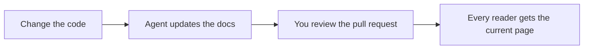

# Components

Components cover what plain Markdown cannot: callouts, steps, tabs, cards, a video. Every one of them renders three ways from the same tag. Readers get a styled component, readers without JavaScript (and crawlers) get complete semantic HTML, and agents get portable Markdown in the page's `.md` twin. You write the tag once.

Each section below shows the component live, then the source that produced it. The prop tables are in the [components reference](../reference/components.md), and you can add your own with [custom components](../customize/custom-components.md).

## How to write one

A component is a PascalCase tag on its own line, with a blank line before and after. Content inside it is Markdown. A component without content closes itself (`<Video ... />`), and a short one can sit on a single line (`<Badge tone="success">Stable</Badge>`). Props are quoted strings; a bare prop means true and JSON goes in braces (`cols={3}`). Each component also has a `:::directive` form, described in [Markdown](markdown.md#directives).

An unknown tag, or a typo such as `<Calout>`, renders as escaped text and never as HTML. `php artisan larecipe:validate` reports it as `components.unknown`, and a missing or invalid prop as `components.props`. A built-in component ignores props it does not declare, so a misspelled prop has no effect: check the [components reference](../reference/components.md) for the exact names.

## Callout

A note, tip or warning set apart from the text. The type sets the label and its color: `note`, `tip`, `important`, `warning`, `caution` or `danger` (`info` and `success` work too). An optional `title` replaces the label.

<Callout type="warning" title="Before you deploy">
Run `php artisan optimize` so the first reader after a deploy never waits for a page to render.
</Callout>

```markdown
<Callout type="warning" title="Before you deploy">
Run `php artisan optimize` so the first reader after a deploy never waits for a page to render.
</Callout>
```

The same callout as a GitHub alert, which also reads well on GitHub:

> [!NOTE]
> Alerts and callout tags produce the same component.

```markdown
> [!NOTE]
> Alerts and callout tags produce the same component.
```

Without JavaScript it is an `<aside role="note">` with its label. Agents read a GitHub alert (`> [!WARNING]`), with the title as a bold first line.

## Steps

A numbered procedure. Each `Step` needs a `title`; its content is Markdown, code blocks included.

<Steps>

<Step title="Require the package">

```bash
composer require larecipe/larecipe
```

</Step>

<Step title="Run the installer">

```bash
php artisan larecipe:install
```

</Step>

<Step title="Open your docs">
Visit `/docs`. Your Introduction page is already there.
</Step>

</Steps>

````markdown
<Steps>

<Step title="Require the package">

```bash
composer require larecipe/larecipe
```

</Step>

<Step title="Run the installer">

```bash
php artisan larecipe:install
```

</Step>

<Step title="Open your docs">
Visit `/docs`. Your Introduction page is already there.
</Step>

</Steps>
````

Steps are an ordered list in HTML, so they need no JavaScript. Agents read a numbered list with each title in bold.

## Tabs

The same information in alternatives the reader picks from: a package manager, a framework, a source driver. Each `Tab` needs a `label`. `default` picks the tab shown first, and tabs that share a `sync` key switch together across the page.

<Tabs sync="driver">

<Tab label="Repository">
Docs live in `docs/` as Markdown, in the same pull request as the code.

```bash
php artisan larecipe:install --driver=repository
```

</Tab>

<Tab label="Database">
Docs live in your database and change through docs migrations.

```bash
php artisan larecipe:install --driver=database
```

</Tab>

</Tabs>

````markdown
<Tabs sync="driver">

<Tab label="Repository">
Docs live in `docs/` as Markdown, in the same pull request as the code.

```bash
php artisan larecipe:install --driver=repository
```

</Tab>

<Tab label="Database">
Docs live in your database and change through docs migrations.

```bash
php artisan larecipe:install --driver=database
```

</Tab>

</Tabs>
````

Without JavaScript every panel is shown in order under its own label, so nothing is hidden from a reader, a crawler or an agent. The browser turns them into tabs. Agents read each tab as a bold label followed by its content.

## CodeGroup

Several code blocks that belong together, shown as tabs over one code panel. Each block's title, or its language, becomes the tab label.

<CodeGroup>

```bash title="Dry run"
php artisan larecipe:upgrade
```

```bash title="Apply"
php artisan larecipe:upgrade --apply
```

</CodeGroup>

````markdown
<CodeGroup>

```bash title="Dry run"
php artisan larecipe:upgrade
```

```bash title="Apply"
php artisan larecipe:upgrade --apply
```

</CodeGroup>
````

Without JavaScript the blocks are shown one after the other, each with its title. Agents read the code fences with their titles.

## Card and CardGroup

A linked block with a title and a short description. `href` takes a relative `.md` link, which resolves like any other link. `CardGroup` lays cards out in columns (`cols`, default 2).

<CardGroup cols="2">

<Card title="Installation" href="../get-started/installation.md">
From `composer require` to a working docs site, with every installer flag.
</Card>

<Card title="Components reference" href="../reference/components.md">
Every prop of every built-in component.
</Card>

</CardGroup>

```markdown
<CardGroup cols="2">

<Card title="Installation" href="../get-started/installation.md">
From `composer require` to a working docs site, with every installer flag.
</Card>

<Card title="Components reference" href="../reference/components.md">
Every prop of every built-in component.
</Card>

</CardGroup>
```

A card is a plain link in HTML. Agents read a list item: `- [Installation](https://...): From composer require ...`. A card without `href` is a block with a title, and `icon` takes a Lucide icon name.

## Columns

Content side by side on wide screens, stacked on narrow ones. `cols` defaults to 2.

<Columns cols="2">

**For people.** A fast site that reads well with or without JavaScript, in light and dark.

**For agents.** The same page as Markdown, plus `llms.txt`, `skill.md` and MCP.

</Columns>

```markdown
<Columns cols="2">

**For people.** A fast site that reads well with or without JavaScript, in light and dark.

**For agents.** The same page as Markdown, plus `llms.txt`, `skill.md` and MCP.

</Columns>
```

Each block inside becomes a column: a paragraph, a card, a code block. Columns are only a layout, so agents read their content in order.

## Accordion and AccordionGroup

Collapsible sections for detail most readers can skip. Each `Accordion` needs a `title`; `open` starts it expanded. `AccordionGroup` keeps a run of them together.

<AccordionGroup>

<Accordion title="Does LaRecipe need Node on my server?">
No. The reader UI ships prebuilt inside the package. Node is needed only to build your own React components, on your machine or in CI.
</Accordion>

<Accordion title="Can my docs stay in my repository?" open>
Yes, that is the default and the recommended source. The database source is there for teams who want an admin UI.
</Accordion>

</AccordionGroup>

```markdown
<AccordionGroup>

<Accordion title="Does LaRecipe need Node on my server?">
No. The reader UI ships prebuilt inside the package. Node is needed only to build your own React components, on your machine or in CI.
</Accordion>

<Accordion title="Can my docs stay in my repository?" open>
Yes, that is the default and the recommended source. The database source is there for teams who want an admin UI.
</Accordion>

</AccordionGroup>
```

Accordions are native `<details>` elements, so they open and close without JavaScript. Agents read each title in bold, followed by its content, always expanded.

## Badge

A short status label. `tone` is `neutral`, `info` (the default), `success`, `warning` or `danger`. Write it on one line.

<Badge tone="success">Stable</Badge>

<Badge tone="warning">Beta</Badge>

```markdown
<Badge tone="success">Stable</Badge>

<Badge tone="warning">Beta</Badge>
```

Agents read the text in bold.

## Button

A link styled as a button, for the one action a page leads to. `variant` is `primary` (the default), `secondary`, `outline` or `ghost`. Use it sparingly: a page with several buttons has no main action.

<Button href="../get-started/installation.md" variant="outline">Install LaRecipe</Button>

```markdown
<Button href="../get-started/installation.md" variant="outline">Install LaRecipe</Button>
```

Without `href` it renders as a static label, as LaRecipe 2 demo buttons did. Agents read a Markdown link.

## FileTree

A folder layout, written as a nested Markdown list inside the tag. Folders end with a slash by convention.

<FileTree>

- docs/
  - larecipe.json
  - 3.x/
    - navigation.json
    - index.md
    - get-started/
      - installation.md

</FileTree>

```markdown
<FileTree>

- docs/
  - larecipe.json
  - 3.x/
    - navigation.json
    - index.md
    - get-started/
      - installation.md

</FileTree>
```

It is a list in every form: agents read the list itself.

## Frame

A caption for media, usually a screenshot or a diagram. Frames make their image zoomable in the browser. The content can be any Markdown: an image, a table, a code block.

<Frame caption="The two commands that install LaRecipe.">

```bash
composer require larecipe/larecipe
php artisan larecipe:install
```

</Frame>

````markdown
<Frame caption="The two commands that install LaRecipe.">

```bash
composer require larecipe/larecipe
php artisan larecipe:install
```

</Frame>
````

For a screenshot, put the image inside: `` between the tags, with the file next to the page or in the version's `_assets` folder.

Without JavaScript it is a `<figure>` with a `<figcaption>`. Agents read the media followed by the caption in italics.

## Video

A video that loads only when the reader asks for it. `src` takes a video file, or a YouTube or Vimeo URL; `poster`, `title` and `duration` fill the frame and its caption. A video file plays in a native `<video>` element. A YouTube or Vimeo URL renders as a "Watch on YouTube" link until the reader starts it, so nothing from a third party loads with the page. LaRecipe works out the player's address from `src` itself, so a page cannot point the player anywhere else.

Until a recording exists, leave out `src`. The frame says what is coming instead of showing an empty box: your `placeholder` text, or "Demo video coming soon" in the page's language when you set none. `php artisan larecipe:validate` keeps reminding you with a `media.placeholder` warning.

<Video placeholder="An example placeholder: this frame stays until the recording exists" />

```markdown
<Video placeholder="An example placeholder: this frame stays until the recording exists" />

<Video src="https://www.youtube.com/watch?v=VIDEO_ID" title="LaRecipe in two minutes" duration="2:40" />
```

Agents read a link with the title and duration (`[Video: LaRecipe in two minutes · 2:40](https://...)`), or a line that says the video is coming.

## Mermaid

A diagram from text. Write a ` ```mermaid ` fence, or the `<Mermaid>` tag with the same source inside.



````markdown

````

The diagram renders in the browser, in the theme's ink and paper, when it scrolls near the viewport. Without JavaScript the source is shown as readable text. Agents read the `mermaid` fence, which most models understand as it is.

## Math

A formula in TeX. Write a `$$` block, or the `<Math>` tag.

$$
e^{i\pi} + 1 = 0
$$

```markdown
$$
e^{i\pi} + 1 = 0
$$
```

The formula is typeset in the browser. Without JavaScript the TeX source is shown, and agents read the `$$` block.

## Live references and gate blocks

Two more families use the same tag syntax. Live references (`<Route>`, `<Artisan>`, `<Model>`, `<Event>`) read facts from your running app, so they cannot go stale: see [live references](live-references.md). Gate blocks (`<Can>`, `<Cannot>`) show a section only to readers your gates allow: see [gate blocks](gate-blocks.md).

## What each component becomes

| Component | Without JavaScript | In agent Markdown |
| --- | --- | --- |
| Callout | an `<aside>` with its label | a GitHub alert |
| Steps | an ordered list | a numbered list |
| Tabs | every panel, each under its label | each tab as a bold label and its content |
| CodeGroup | every block, each with its title | the code fences |
| Card | a link with title and description | `- [Title](url): description` |
| Columns | the columns | their content |
| Accordion | a native `<details>` | the title in bold, then the content |
| Badge | a label | the text in bold |
| Button | a link | a Markdown link |
| FileTree | the nested list | the nested list |
| Frame | a `<figure>` with its caption | the media, then the caption in italics |
| Video | a `<video>`, a watch link or the placeholder frame | a link, or a "coming soon" line |
| Mermaid | the diagram source | a `mermaid` fence |
| Math | the TeX source | a `$$` block |
